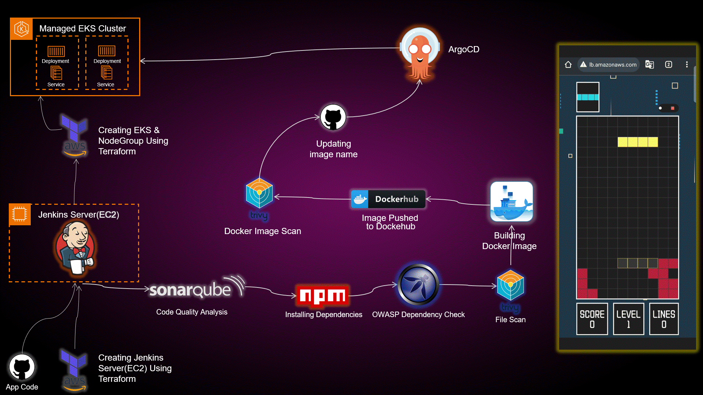

# Geemu – DevSecOps Pipeline on AWS

Geemu takes code from GitHub to a running app on Amazon EKS with no manual steps, and scans it for security issues on the way. The app it deploys is a Tetris web game.

CS365 capstone project, Thammasat University (Mar–May 2026), built by a team of two.



## How it works

1. A push to the `develop` branch starts a GitHub Actions workflow, which calls the Jenkins job.
2. Jenkins scans the code (SonarQube, OWASP Dependency-Check, Trivy), builds a Docker image, pushes it to Docker Hub, and scans the image with Trivy.
3. Jenkins writes the new image tag into the Kubernetes manifest and pushes it back to Git with `[skip ci]`, so it does not start another build.
4. ArgoCD sees the manifest change and deploys the new version to Amazon EKS.

Terraform creates both the Jenkins server (EC2) and the EKS cluster.

## Tech stack

| Area | Tools |
| --- | --- |
| Cloud | AWS (EC2, EKS, VPC) |
| Infrastructure as code | Terraform (state in S3, locking with DynamoDB) |
| CI/CD | Jenkins, GitHub Actions |
| Code and security scans | SonarQube (SAST), OWASP Dependency-Check, Trivy (files and images) |
| Containers | Docker, Docker Hub |
| Deployment | Kubernetes (EKS), ArgoCD (GitOps) |
| App | React (Tetris game) |

## Repository structure

```text
.
├── .github/workflows/trigger-jenkins.yml   # Starts the Jenkins job on push to develop
├── infrastructure/
│   ├── jenkins-ec2/                        # Terraform: VPC, EC2 (t3a.large) for Jenkins
│   │   └── tools-install.sh                # Installs Jenkins, Docker, SonarQube, Terraform, kubectl, AWS CLI, Trivy
│   └── eks-cluster/                        # Terraform: VPC, EKS cluster, node group (2 nodes, up to 3)
├── pipelines/
│   ├── 00-deploy-jenkins.jenkinsfile       # Terraform plan/apply/destroy for the Jenkins server
│   ├── 01-deploy-eks.jenkinsfile           # Terraform for EKS, then installs ArgoCD
│   ├── 02-deploy-tetrisV1.jenkinsfile      # CI/CD for Tetris V1
│   └── 03-deploy-tetrisV2.jenkinsfile      # CI/CD for Tetris V2 (current)
├── k8s-manifests/tetris-deployment.yaml    # Deployment (2 replicas) + LoadBalancer service
├── tetris-app/                             # Tetris V1
└── Tetris-V2/                              # Tetris V2
```

## Pipelines

### 01 – EKS cluster and ArgoCD

Choose `plan`, `apply`, or `destroy` when you run it.

1. Check out the code.
2. Run Terraform in `infrastructure/eks-cluster`.
3. Update kubeconfig for `Geemu-EKS-Cluster` and check the nodes.
4. Install ArgoCD, expose it with a LoadBalancer, and print its URL and admin password.

Every step can run again safely: it skips resources that already exist.

### 03 – Tetris V2 CI/CD (12 stages)

One run takes about 3 minutes.

1. Clean the workspace
2. Check out the code
3. Run SonarQube (SAST)
4. Wait for the quality gate
5. Install dependencies (npm)
6. Scan dependencies with OWASP Dependency-Check (on in V1, off in V2 for the demo)
7. Scan files with Trivy
8. Build the Docker image
9. Push to Docker Hub (tagged with the build number and `latest`)
10. Scan the image with Trivy
11. Check out the Kubernetes manifests
12. Update the image tag and push with `[skip ci]`; ArgoCD deploys it

## Setup

### What you need

- An AWS account (we used AWS Learner Lab), region `us-east-1`
- An S3 bucket and a DynamoDB table for Terraform state (see `backend.tf`)
- A Docker Hub account and a GitHub token

### Steps

1. **Jenkins server:** run Terraform in `infrastructure/jenkins-ec2` (or pipeline `00`). The server installs its tools from `tools-install.sh` on first boot.
2. **Jenkins setup:** add the tools `nodejs`, `sonar-scanner`, and `docker`, the SonarQube server `sonar-server`, and these credentials:

   | ID | Used for |
   | --- | --- |
   | `aws-access-key-id`, `aws-secret-access-key`, `aws-session-token` | Terraform and kubectl (pipeline 01) |
   | `docker` | Docker Hub login |
   | `github` | Pushing the updated manifest |
   | `sonar-token` | SonarQube quality gate |

3. **EKS and ArgoCD:** run pipeline `01` with `apply`.
4. **ArgoCD app:** in ArgoCD, create an app that watches `k8s-manifests/` on the `develop` branch.
5. **GitHub Actions:** add the secrets `JENKINS_URL`, `JENKINS_JOB_TOKEN`, and `JENKINS_TOKEN`.
6. Push to `develop`. The pipeline runs, and the game appears at the `tetris-service` LoadBalancer URL.

## Problems we solved

| Problem | Fix |
| --- | --- |
| Jenkins pushed the new tag to Git, which re-triggered the webhook: endless build loop | Trigger from GitHub Actions, which skips `[skip ci]` commits |
| AWS Learner Lab gave worker nodes new IPs every session | Removed the old nodes; Auto Scaling created new ones, and Kubernetes moved the pods over |
| The Jenkins server IP changed on every lab start | Attached an Elastic IP |
| Not enough RAM to run Jenkins and SonarQube on one server | Added 4 GB swap, capped Jenkins at 3 GB, and raised `vm.max_map_count` so SonarQube could start |
| The tutorial's settings (versions, paths, credentials) did not match our setup | Found the failing stage in the logs and updated the branch, paths, and credentials |

## Team

- Tanat Kerdtip – EKS Terraform, EKS and ArgoCD pipeline, Tetris V2 CI/CD pipeline, GitHub Actions trigger, Kubernetes manifest; Jenkins server (with Natchanon)
- Natchanon Sarasang – Jenkins server Terraform and setup script, pipeline fixes, Dockerfile

## Credits

- Tetris V2 is based on [react-tetris](https://github.com/mpirescarvalho/react-tetris) by mpirescarvalho.
- The pipeline started from an end-to-end Kubernetes DevSecOps tutorial, which we changed to fit our setup.
